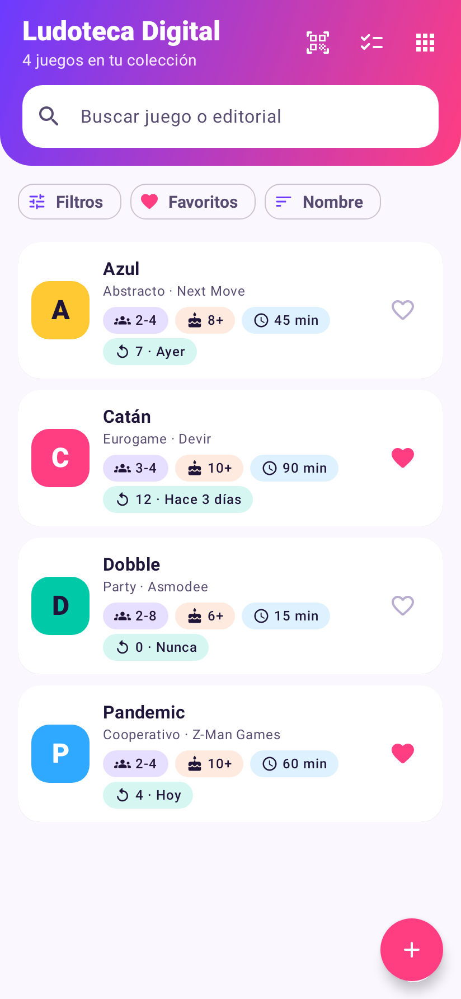
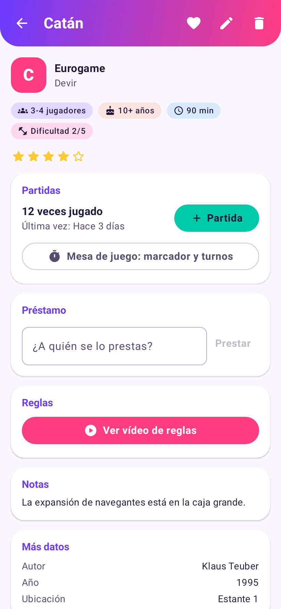
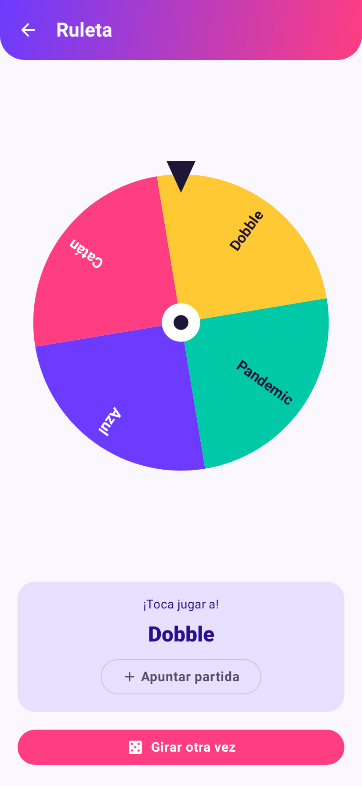
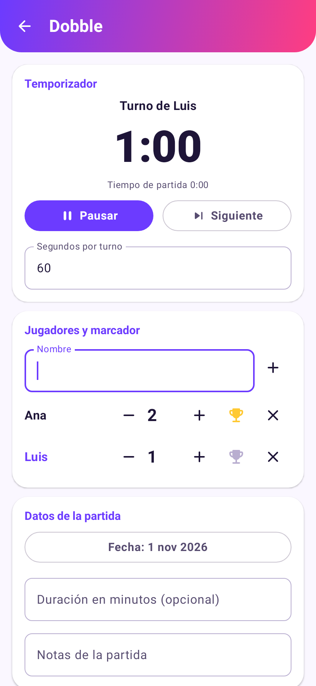
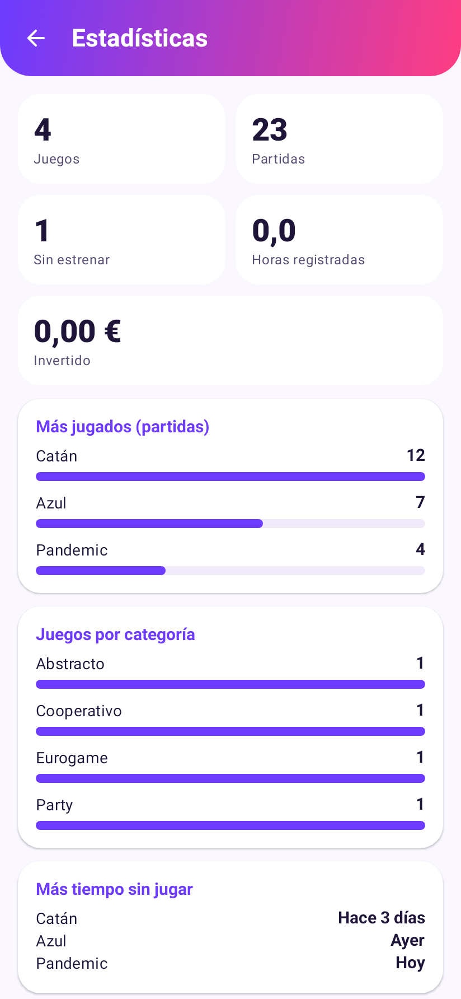
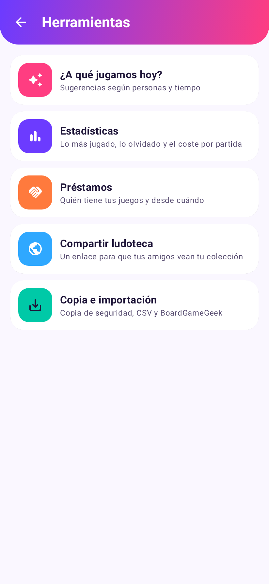

# Ludoteca Digital 🎲

Ludoteca Digital es una app Android para llevar el inventario de tus juegos de mesa. Con ella sabes qué tienes,
a qué juegas y a quién se lo has prestado. También ayuda a decidir a qué jugar hoy.

Es gratuita, no necesita cuenta y no tiene anuncios. Tu colección se guarda solo en tu móvil.

| | | |
|:---:|:---:|:---:|
|  |  |  |
| Tu colección | Ficha del juego | Ruleta |
|  |  |  |
| Mesa de juego | Estadísticas | Herramientas |

## Descargar e instalar

**[⬇️ Descargar ludoteca-digital.apk](apk/ludoteca-digital.apk)** (21 MB, Android 8.0 o superior)

1. Abre el APK en el móvil, desde Descargas o desde la app Archivos.
2. Si Android lo pide, permite «Instalar apps desconocidas» para esa app y vuelve atrás.
3. Pulsa **Instalar**. Si Google Play Protect avisa de que no reconoce la app, elige «Instalar de todas
   formas». Avisa porque la app no está publicada en Google Play.

## Qué puedes hacer

### Tu colección

- **Ficha de cada juego.** Guarda nombre, editorial, autor, año, número de jugadores, categoría, edad
  recomendada, duración, dificultad (1 a 5), tu valoración (1 a 5 estrellas), ubicación en tu estantería, precio
  de compra y notas.
- **Foto de la caja,** desde la cámara o la galería. Si no pones foto, el juego lleva un avatar de color con su
  inicial.
- **Favoritos,** para marcar tus juegos preferidos con un corazón.
- **Vídeo de reglas.** La app busca en YouTube un vídeo que explique cómo se juega y lo guarda en la ficha. Si
  no encuentra uno adecuado, abre la búsqueda para que elijas tú.
- **Código de barras.** Escanea la caja para empezar la ficha. Si el código está en la base de datos pública,
  rellena el nombre y la editorial. Si no, apuntas el resto a mano y el código queda guardado.

### Buscar y filtrar

- **Búsqueda** por nombre, editorial o autor. No distingue mayúsculas ni tildes.
- **Filtros combinables:** categoría, editorial, número de jugadores, edad, duración máxima, dificultad,
  valoración mínima, solo favoritos, nunca jugados y prestados.
- **Orden** por nombre, añadidos recientemente, jugados hace poco, más tiempo sin jugar, más jugados o mejor
  valorados.

Categorías disponibles: Estrategia, Eurogame, Familiar, Party, Cartas, Cooperativo, Temático, Deducción,
Abstracto, Rol, Infantil y Otro.

### Partidas

- **Contador de partidas.** Cada juego muestra cuántas veces lo has jugado y cuándo fue la última.
- **Historial.** Cada partida guarda fecha, duración, participantes, puntuaciones, ganador y notas. Puedes
  apuntar partidas pasadas con su fecha real.
- **Mesa de juego.** Es un marcador para usar mientras jugáis, con temporizador por turnos que avisa cuando se
  acaba el tiempo. Al terminar, la partida se guarda en el historial con su resultado.

### Decidir a qué jugar

- **¿A qué jugamos hoy?** Indica cuántos sois y, si quieres, el tiempo disponible y la edad del más pequeño. La
  app sugiere juegos de tu colección que encajan, priorizando los que más te gustan y los que llevan tiempo en
  la estantería. Los juegos prestados no aparecen.
- **Ruleta.** Selecciona varios juegos y gira la ruleta para que el azar decida.
- **Encuesta anónima.** Selecciona varios juegos y crea una votación en
  [Polling.com](https://polling.com). Compartes el enlace por WhatsApp o donde quieras, y cada uno vota sin
  registrarse ni instalar nada. Puede ser de una sola opción, de varias opciones o por ranking.

### Seguimiento

- **Estadísticas:** juegos, partidas, horas jugadas, dinero invertido, juegos sin estrenar, los más jugados, los
  que llevan más tiempo sin jugarse, coste por partida, juegos por categoría y quién gana más.
- **Préstamos.** Apunta a quién has prestado un juego y desde cuándo. Una pantalla reúne todos los préstamos
  para que no se te olvide ninguno.

### Compartir y guardar

- **Compartir tu ludoteca.** Crea una página web con tu colección, para que tus amigos vean qué juegos tienes.
  Solo se publican nombre, editorial, jugadores, edad y duración.
- **Copia de seguridad.** Guarda en un único archivo toda la colección, con partidas y fotos, y restáurala en
  otro móvil o tras reinstalar.
- **Importar y exportar CSV.** Pasa tu colección a una hoja de cálculo o cárgala desde una.
- **Importar desde BoardGameGeek.** Exporta tu colección desde BGG en CSV y cárgala en la app. BGG no incluye
  la categoría en ese archivo, así que esos juegos entran como «Otro».

## Privacidad

Tus datos se guardan solo en el móvil. La app no tiene cuenta ni servidor propio. Solo se conecta a internet
para lo que pides expresamente:

| Función | Servicio | Qué se envía |
|---|---|---|
| Vídeo de reglas | YouTube | El nombre del juego |
| Código de barras | [UPCitemdb](https://www.upcitemdb.com) | El código escaneado |
| Encuesta | [Polling.com](https://polling.com) | La pregunta y los nombres de los juegos |
| Compartir ludoteca | [Telegraph](https://telegra.ph) | Nombre, editorial, jugadores, edad y duración de cada juego |

Las encuestas y la página de tu ludoteca son públicas para quien tenga el enlace. Telegraph no permite borrar
páginas: al dejar de compartir, la app vacía la página. Tus notas, precios, fotos, préstamos y partidas nunca
salen del móvil, salvo en las copias de seguridad que guardes tú.

## Limitaciones conocidas

- **Versión de pruebas.** Haz una copia de seguridad desde **Herramientas → Copia e importación** antes de
  instalar una versión nueva.
- **Códigos de barras:** la base de datos gratuita tiene un límite diario de consultas y conoce sobre todo
  ediciones estadounidenses. Muchas ediciones españolas no aparecen.
- **Escáner:** usa el de Google, que necesita los servicios de Google Play. No pide permiso de cámara.
- **Vídeo de reglas:** la búsqueda no usa una API oficial de YouTube. Si YouTube cambia su web, la app abrirá
  la búsqueda para que elijas el vídeo a mano.
